# 第三章 JavaScript

# 一 JS简介

## 1.1 JS起源

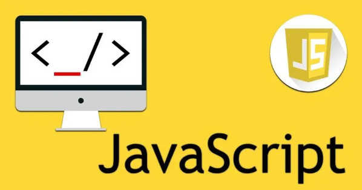

> Javascript是一种由Netscape(网景)的LiveScript发展而来的原型化继承的面向对象的动态类型的区分大小写的`客户端脚本语言`，主要目的是为了解决服务器端语言，遗留的速度问题，于是Netscape的浏览器Navigator加入了Javascript，提供了数据验证的基本功能。ECMA-262 是正式的 JavaScript 标准。这个标准开发始于 1996 年，在 1997 年 7 月，ECMA 会员大会采纳了它的首个版本。这个标准由 ECMA 组织发展和维护。JavaScript 的正式名称是 "ECMAScript"。JavaScript的组成包含ECMAScript、DOM、BOM。`JS是一种运行于浏览器端上的小脚本语句,可以实现网页如文本内容动,数据动态变化和动画特效等`。JS有 如下特点：

+ **`脚本语言`**：JavaScript是一种解释型的脚本语言。不同于C、C++、Java等语言先编译后执行,	JavaScript不会产生编译出来的字节码文件，而是在程序的运行过程中对源文件逐行进行解释；
  
+ **`基于对象`**：JavaScript是一种基于对象的脚本语言，它不仅可以创建对象，也能使用现有的对象。但是面向对象的三大特性：『封装』、『继承』、『多态』中，JavaScript能够实现封装，可以模拟继承，不支持多态，所以它不是一门面向对象的编程语言；
+ **`弱类型`**：JavaScript中也有明确的数据类型，但是声明一个变量后它可以接收任何类型的数据，并且会在程序执行过程中根据上下文自动转换类型；
+ **`事件驱动`**：JavaScript是一种采用事件驱动的脚本语言，它不需要经过Web服务器就可以对用户的输入做出响应；
+ **`跨平台性`**：JavaScript脚本语言不依赖于操作系统，仅需要浏览器的支持。因此一个JavaScript脚本在编写后可以带到任意机器上使用，前提是机器上的浏览器支持JavaScript脚本语言。目前JavaScript已被大多数的浏览器所支持；

## 1.2 JS 组成部分

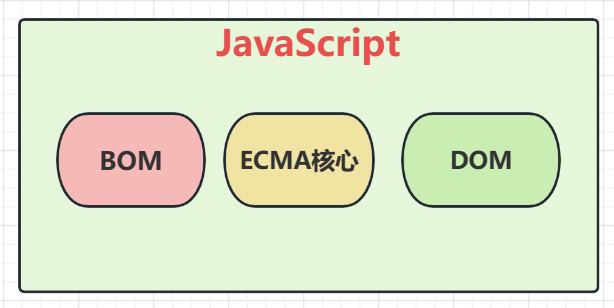

> ECMA 及版本变化：

+ 是一种由欧洲计算机制造商协会（ECMA）通过ECMA-262标准化的脚本程序语言,ECMAScript描述了语法、类型、语句、关键字、保留字、运算符和对象。它就是定义了脚本语言的所有属性、方法和对象；
+  ECMA-262第1版本质上跟网景的JavaScript 1.1相同；
+ ECMA-262第2版只是做了一些编校工作，并没有增减或改变任何特性；
+  ECMA-262第3版第一次真正对ECMAScript进行更新；
+  ECMA-262第4版是对这门语言的一次彻底修订；  
+  ECMA-262第5版是ECMA-262第3版的小幅改进，于2009年12月3日正式发布； 
+  ECMA-262第6版-ES6、于2015年6月发布。`这一版包含了大概这个规范有史以来最重要的一批增强特性。`但是并不是所有的浏览器都全面支持；
+   ECMA-262第7版也称为ES7或ES2016，于2016年6月发布；
+  ECMA-262第8版也称为ES8、ES2017，完成于2017年6月； 
+  ECMA-262第9版也称为ES9、ES2018，发布于2018年6月；
+  ECMA-262第10版也称为ES10、ES2019，发布于2019年6月；
+  ECMA-262第11版，也成为ES11、ES2020，发布于2020年6月；
+  ... ... 

> BOM编程：

+ BOM是Browser Object Model的简写，即浏览器对象模型；

+ BOM有一系列对象组成，是访问、控制、修改浏览器的属性和方法；

+ BOM没有统一的标准(每种客户端都可以自定标准)；

+ BOM编程是将浏览器窗口的各个组成部分抽象成各个对象，通过各个对象的API操作组件行为的一种编程；


> DOM编程：

+ 简单来说，DOM编程就是使用document对象的API完成对网页HTML文档进行动态修改，以实现网页数据和样式动态变化效果的编程；
+ document对象代表整个html文档，可用来访问页面中的所有元素，是最复杂的一个dom对象，可以说是学习好dom编程的关键所在；

+ DOM编程其实就是用window对象的document属性的相关API完成对页面元素的控制的编程；

## 1.3 JS的引入方式

> 1、内部脚本方式引入：

+ 在页面中，通过一对script标签引入JS代码；
+ script代码放置位置有一定的随意性，一般放在head标签中；

``` html
<!DOCTYPE html>
<html lang="en">
    <head>
        <meta charset="UTF-8">
        <title>小标题</title>
        <script>
            function suprise(){
                alert("Hello,我是惊喜")
            }
        </script>
    </head>
    <body>
        <button  onclick="suprise()">点我有惊喜</button>
    </body>
</html>
```

> 2、外部脚本方式引入：

+ 内部脚本仅能在当前页面上使用，代码复用度不高；
+ 可以将脚本放在独立的js文件中，通过script标签引入外部脚本文件；
+ 一对script标签要么用于定义内部脚本，要么用于引入外部js文件，不能混用；
+ 一个html文档中，可以有多个script标签 ；
+ 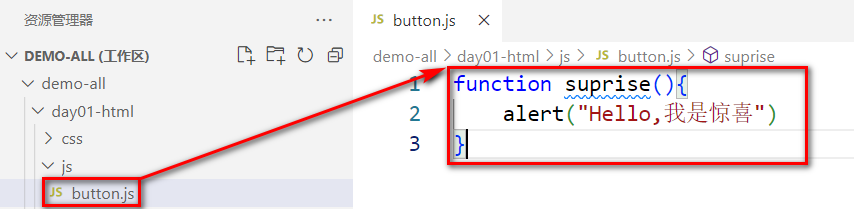

``` html
<!DOCTYPE html>
<html lang="en">
    <head>
        <meta charset="UTF-8">
        <title>小标题</title>
        <script src="js/button.js" type="text/javascript"></script>
    </head>
    <body>
        <button  onclick="suprise()">点我有惊喜</button>
    </body>
</html>
```

# 二 JS的数据类型和运算符

## 2.1 JS的数据类型

> 数值类型：数值类型统一为 number，不区分整数和浮点数。

> 字符串类型：字符串类型为 string 和JAVA中的String相似，JS中不严格区分单双引号，都可以用于表示字符串。

> 布尔类型：布尔类型为boolean 和Java中的boolean相似，但是在JS的if语句中，非空字符串会被转换为'真'，非零数字也会被认为是'真'。

> 引用数据类型：引用数据类型对象是Object类型，各种对象和数组在JS中都是Object类型。

> function类型：JS中的各种函数属于function数据类型。

> 命名未赋值：js为弱类型语言，统一使用 var 声明对象和变量，在赋值时才确定真正的数据类型，变量如果只声明没有赋值的话,数据类型为undefined。

> 赋予NULL值：在JS中，如果给一个变量赋值为null，其数据类型是Object，可以通过typeof关键字判断数据类型。

## 2.2 JS的变量

> JS中的变量具有如下特征：

1 、弱类型变量，可以统一声明成var；

2 、var声明的变量可以再次声明；

3 、变量可以使用不同的数据类型多次赋值；

4 、JS的语句可以以; 结尾，也可以不用;结尾；

5 、变量标识符严格区分大小写；

6 、标识符的命名规则参照JAVA；

7 、如果使用了 一个没有声明的变量，那么运行时会报：uncaught ReferenceError: *** is not defined   at index.html:行号:列号 ；

8 、如果一个变量只声明，没赋值，那么值是undefined；

## 2.3 JS的运算符

>  算数运算符：  + - * /  %

+ 其中需要注意的是 / 和 % 
    + / 在除0时，结果是Infinity ，而不是报错；
    + %在模0时，结果是NaN，意思为 not a number ，而不是报错；

> 复合算数运算符： ++ --  += -= *= /= %=

+ 符合算数运算符基本和JAVA一致,同样需要注意 /=和%=
    + 在/=0时，结果是Infinity ，而不是报错；
    + 在%=0时，结果是NaN，意思为 not a number ，而不是报错；

> 关系运算符：  >   <  >= <= == === !=

+ 需要注意的是 == 和 === 差别
    + == 符号，如果两端的数据类型不一致，会尝试将两端的数据转换成number，再对比number大小。
        + '123'  这种字符串可以转换成数字；
        + true会被转换成1 ，false会被转换成0；
    + ===  符号，如果两端数据类型不一致，直接返回false，数据类型一致再比较是否相同。

> 逻辑运算符：  || &&    

+ 几乎和JAVA中的一样，需要注意的是，这里直接就是短路的逻辑运算符，单个的 |   和 &  以及 ^ 是位运算符。

> 条件运算符：  条件? 值1  : 值2

+ 几乎和JAVA中的一样。

> 位运算符：  |  &  ^  <<  >>  >>>

+ 和 java中的类似(了解)。

# 三 JS的流程控制和函数

## 3.1 JS分支结构

> if结构：

+ 这里的if结构几乎和JAVA中的一样，需要注意的是：
    + if()中的非空字符串会被认为是true；
    + if()中的非零数字会被认为是true；


``` javascript
if('false'){// 非空字符串 if判断为true
    console.log(true)
}else{
    console.log(false)
}
if(''){// 长度为0字符串 if判断为false
    console.log(true)
}else{
    console.log(false)
}
if(1){// 非零数字 if判断为true
    console.log(true)
}else{
    console.log(false)
}
if(0){
    console.log(true)
}else{
    console.log(false)
}
```

> switch结构：

``` javascript
var monthStr=prompt("请输入月份","例如:10 ");
var month= Number.parseInt(monthStr)
switch(month){
    case 3:
    case 4:
    case 5:
        console.log("春季");
        break;
    case 6:
    case 7:
    case 8:
        console.log("夏季");
        break;
    case 9:
    case 10:
    case 11:
        console.log("秋季");
        break;
    case 1:
    case 2:
    case 12:
        console.log("冬季");
        break;
    default :
        console.log("月份有误")
}
```

## 3.2 JS循环结构

> while结构：

```  javascript
/* 打印99 乘法表 */
var i = 1;
while(i <= 9){
    var j = 1;
    while(j <= i){
        document.write(j+"*"+i+"="+i*j+"&nbsp;&nbsp;&nbsp;&nbsp;&nbsp;");
        j++;
    }
    document.write("<hr/>");
    i++;
}
```

> for循环：

``` javascript
/* 打印99 乘法表 */
for(  var i = 1;i <= 9; i++){
    for(var j = 1;j <= i;j++){
        document.write(j+"*"+i+"="+i*j+"&nbsp;&nbsp;&nbsp;&nbsp;&nbsp;");
    }
    document.write("<hr/>");
}
```

> foreach循环：

+ 迭代数组时，和java不一样。
    + 括号中的临时变量表示的是元素的索引，不是元素的值。
    + ()中也不在使用: 分隔，而是使用 in 关键字。


``` javascript
var cities =["北京","上海","深圳","武汉","西安","成都"]
document.write("<ul>")
for(var index in  cities){
    document.write("<li>"+cities[index]+"</li>")
}
document.write("</ul>")
```

## 3.3 JS函数声明

> JS中的方法，多称为函数，函数的声明语法和JAVA中有较大区别。

+ 函数说明
    + 函数没有权限控制符。
    + 不用声明函数的返回值类型，需要返回在函数体中直接return即可，也无需void关键字。
    + 参数列表中，无需数据类型。
    + 调用函数时，实参和形参的个数可以不一致。
    + 声明函数时需要用function关键字。
    + J函数没有异常列表。
+ 代码

``` javascript
/* 语法1 ：function 函数名 (参数列表){函数体} */
function sum(a, b){
    return a+b;
}
var result =sum(10,20);
console.log(result)
/* 语法2 ： var 函数名 = function (参数列表){函数体}  */
var add = function(a, b){
    return a+b;
}
var result = add(1,2);
console.log(result);
```

# 四 JS的对象和JSON

## 4.1 JS声明对象的语法

> 语法1， 通过new Object()直接创建对象：

```javascript
var person =new Object();
// 给对象添加属性并赋值
person.name="张小明";
person.age=10;
person.foods=["苹果","橘子","香蕉","葡萄"];
// 给对象添加功能函数
person.eat= function (){
    console.log(this.age+"岁的"+this.name+"喜欢吃:")
    for(var i = 0;i<this.foods.length;i++){
        console.log(this.foods[i])
    } 
}
//获得对象属性值
console.log(person.name)
console.log(person.age)
//调用对象方法
person.eat();
```

> 语法2，通过 {}形式创建对象：

``` javascript
var person ={
    "name":"张小明",
    "age":10,
    "foods":["苹果","香蕉","橘子","葡萄"],
    "eat":function (){
        console.log(this.age+"岁的"+this.name+"喜欢吃:")
        for(var i = 0;i<this.foods.length;i++){
            console.log(this.foods[i])
        } 
    }
}
//获得对象属性值
console.log(person.name)
console.log(person.age)
//调用对象方法
person.eat();
```

## 4.2 JSON格式

>  JSON（JavaScript Object Notation, JS对象简谱）是一种轻量级的数据交换格式。它基于ECMAScript（European Computer Manufacturers Association, 欧洲计算机协会的一个子集，采用完全独立于编程语言的文本格式来存储和表示数据。简洁和清晰的层次结构使得 JSON 成为理想的数据交换语言。 易于人阅读和编写，同时也易于机器解析和生成，并有效地提升网络传输效率，`简单来说,JSON 就是一种字符串格式，这种格式无论是在前端还是在后端，都可以很容易地和对象之间进行转换，所以常用于前后端数据传递`。

+ JSON的语法：var str="{'属性名':'属性值','属性名':{'属性名':'属性值'},'属性名':['值1','值1','值3']}" ；

+ JSON字符串一般用于传递数据，一般都是用对象的属性表示数据，所以在此不研究对象的函数，只看对象的属性；

+ 通过JSON.parse()方法可以将一个JSON串转换成对象；

+ 通过JSON.stringify()方法可以将一个对象转换成一个JSON格式的字符串；

``` javascript
/* 定义一个JSON串 */
var personStr ='{"name":"张小明","age":20,"girlFriend":{"name":"铁铃","age":23},"foods":["苹果","香蕉","橘子","葡萄"],"pets":[{"petName":"大黄","petType":"dog"},{"petName":"小花","petType":"cat"}]}'
console.log(personStr)
console.log(typeof personStr)
/* 将一个JSON串转换为对象 */
var person =JSON.parse(personStr);
console.log(person)
console.log(typeof person)
/* 获取对象属性值 */
console.log(person.name)
console.log(person.age)
console.log(person.girlFriend.name)
console.log(person.foods[1])
console.log(person.pets[1].petName)
console.log(person.pets[1].petType)
```

``` javascript
/* 定义一个对象 */
var person={
    'name':'张小明',
    'age':20,
    'girlFriend':{
        'name':'铁铃',
        'age':23
    },
    'foods':['苹果','香蕉','橘子','葡萄'],
    'pets':[
        {
            'petName':'大黄',
            'petType':'dog'
        },
        {
            'petName':'小花',
            'petType':'cat'
        }
    ]
}

/* 获取对象属性值 */
console.log(person.name)
console.log(person.age)
console.log(person.girlFriend.name)
console.log(person.foods[1])
console.log(person.pets[1].petName)
console.log(person.pets[1].petType)
/* 将对象转换成JSON字符串 */
var personStr =JSON.stringify(person)
console.log(personStr)
console.log(typeof personStr)
```

+ 前后端传递数据
+ 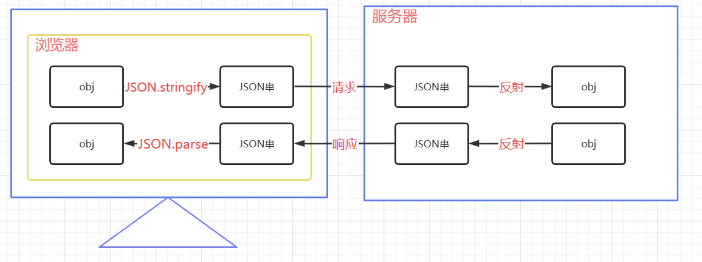


## 4.3 JS常见对象

### 4.3.1 数组

> 创建数组的四种方式：

+ new Array()                                                   创建空数组
+ new Array(5)                                                 创建数组时给定长度
+ new Array(ele1,ele2,ele3,... ... ,elen);          创建数组时指定元素值
+ [ele1,ele2,ele3,... ... ,elen];                           相当于第三种语法的简写

> 数组的常见API见： https://www.runoob.com/jsref/jsref-obj-array.html

### 4.3.2 Boolean对象

> boolean常见API见：https://www.runoob.com/jsref/jsref-obj-boolean.html

### 4.3.3 Date对象

> Date常见API见：https://www.runoob.com/jsref/jsref-obj-date.html

### 4.3.4 Math

>  Math常见API见：https://www.runoob.com/jsref/jsref-obj-math.html

### 4.3.5 Number

> Number常见API见：https://www.runoob.com/jsref/jsref-obj-number.html

### 4.3.6 String

> String常见API见：https://www.runoob.com/jsref/jsref-obj-string.html

# 五 事件的绑定

## 5.1 什么是事件

>  HTML 事件可以是浏览器行为，也可以是用户行为。 当这些一些行为发生时，可以自动触发对应的JS函数的运行。`JS的事件驱动指的就是行为触发代码运行的这种特点`。

## 5.2 常见事件

> 鼠标事件： https://www.runoob.com/jsref/dom-obj-event.html

> 键盘事件： https://www.runoob.com/jsref/dom-obj-event.html

> 表单事件： https://www.runoob.com/jsref/dom-obj-event.html

## 5.3 事件的绑定

> 通过属性绑定：

``` html
    <head>
        <meta charset="UTF-8">
        <title>小标题</title>      
        <script>
            function testDown1(){console.log("down1")}
            function testDown2(){console.log("down2")}
            function testFocus(){console.log("获得焦点")}
            function testBlur(){ console.log("失去焦点") }
            function testChange(input){console.log("内容改变");console.log(input.value);}
            function testMouseOver(){ console.log("鼠标悬停") }
            function testMouseLeave(){ console.log("鼠标离开")}
            function testMouseMove(){ console.log("鼠标移动")}
        </script>
    </head>

    <body>
        <input type="text" 
        onkeydown="testDown1(),testDown2()"
        onfocus="testFocus()" 
        onblur="testBlur()" 
        onchange="testChange(this)"
        onmouseover="testMouseOver()" 
        onmouseleave="testMouseLeave()" 
        onmousemove="testMouseMove()" 
         />
    </body>
```

+ 通过事件属性绑定函数，在行为发生时会自动执行函数。
+ 一个事件可以同时绑定多个函数。

+ 一个元素可以同时绑定多个事件。
+ 方法中可以传入 this对象，代表当前元素。

## 5.4 事件的触发

> 行为触发：

+ 发生行为时触发，演示：略

> DOM编程触发：

+ 通过DOM编程，用代码触发，执行某些代码相当于发生了某些行为。


``` html
    <head>
        <meta charset="UTF-8">
        <title>小标题</title>    
        <script>
            // 页面加载完毕事件,浏览器加载完整个文档行为
            window.onload=function(){
                var in1 =document.getElementById("in1");
                // 通过DOM编程绑定事件
                in1.onchange=testChange
            }
            function testChange(){
                console.log("内容改变")
                console.log(event.target.value);
            }
        </script>
    </head>
    <body>
        <input id="in1" type="text" />
    </body>
```

# 六 BOM编程

## 6.1 什么是BOM

+ BOM是Browser Object Model的简写，即浏览器对象模型；

+ BOM由一系列对象组成，是访问、控制、修改浏览器的属性和方法；

+ BOM没有统一的标准(每种客户端都可以自定标准)；

+ BOM编程是将浏览器窗口的各个组成部分抽象成各个对象，通过各个对象的API操作组件行为的一种编程；

+ BOM编程的对象结构如下:

    + window 顶级对象，代表整个浏览器窗口；
        + location属性，代表浏览器的地址栏；
        + history属性，代表浏览器的访问历史；
        + screen属性，代表屏幕；
        + navigator属性，代表浏览器软件本身；
        + document属性，代表浏览器窗口目前解析的html文档；
        + console属性，代表浏览器开发者工具的控制台；
        + localStorage属性，代表浏览器的本地数据持久化存储；
        + sessionStorage属性，代表浏览器的本地数据会话级存储；
        + 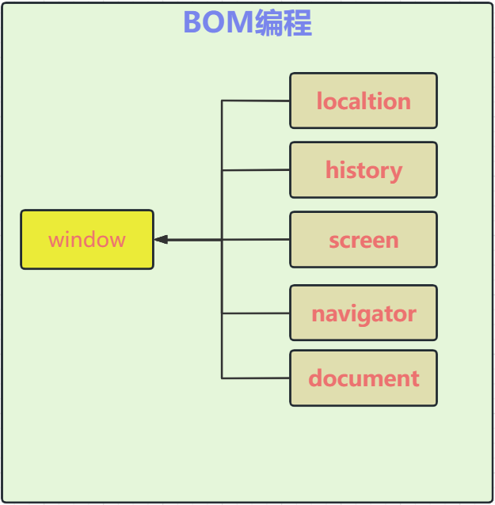
    

##  6.2 window对象的常见属性(了解)

+ window对象常见属性见：https://www.runoob.com/jsref/obj-window.html

## 6.3 window对象的常见方法(了解)

+ window对象常见方法见：https://www.runoob.com/jsref/obj-window.html

## 6.4 通过BOM编程控制浏览器行为演示

>  三种弹窗方式：

``` html
    <head>
        <meta charset="UTF-8">
        <title>小标题</title>      
        <script>
           function testAlert(){
                //普通信息提示框
                window.alert("提示信息");
           }
           function testConfirm(){
                //确认框
                var con =confirm("确定要删除吗?");
                if(con){
                    alert("点击了确定")
                }else{
                    alert("点击了取消")
                }
           }
           function testPrompt(){
                //信息输入对话框
                var res =prompt("请输入昵称","例如:张三");
                alert("您输入的是:"+res)
           }
        </script>
    </head>

    <body>
        <input type="button" value="提示框" onclick="testAlert()"/> <br>
        <input type="button" value="确认框" onclick="testConfirm()"/> <br>
        <input type="button" value="对话框" onclick="testPrompt()"/> <br>
    </body>
```

>  页面跳转：

``` html
    <head>
        <meta charset="UTF-8">
        <title>小标题</title>
        <script>
           function goAtguigu(){
                var flag =confirm("即将跳转到尚硅谷官网,本页信息即将丢失,确定吗?")
                if(flag){
                    // 通过BOM编程地址栏url切换
                    window.location.href="http://www.atguigu.com"
                }
           }          
        </script>
    </head>
    <body>
        <input type="button" value="跳转到尚硅谷" onclick="goAtguigu()"/> <br>
    </body>
```

## 6.5 通过BOM编程实现会话级和持久级数据存储

+ 会话级数据 ：内存型数据，是浏览器在内存上临时存储的数据，浏览器关闭后数据失去，通过window的sessionStorge实现；

+ 持久级数据 ：磁盘型数据，是浏览器在磁盘上持久存储的数据，浏览器关闭后数据仍在，通过window的localStorge实现；

+ 在F12开发者工具的应用程序栏，可以查看数据的状态；

+ 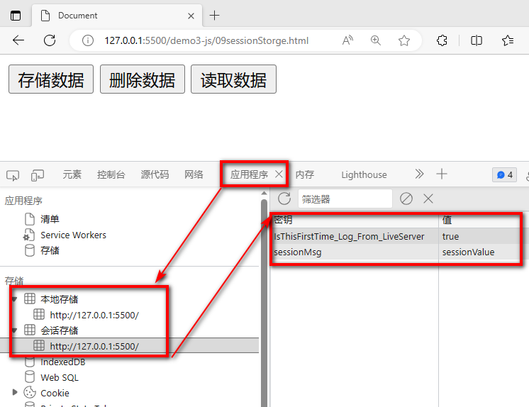

``` html
<!DOCTYPE html>
<html lang="en">
<head>
    <meta charset="UTF-8">
    <meta name="viewport" content="width=device-width, initial-scale=1.0">
    <title>Document</title>
    <script>
        function saveItem(){
            // 让浏览器存储一些会话级数据
            window.sessionStorage.setItem("sessionMsg","sessionValue")
            // 让浏览器存储一些持久级数据
            window.localStorage.setItem("localMsg","localValue")
            console.log("haha")
        }
        function removeItem(){
            // 删除数据
            sessionStorage.removeItem("sessionMsg")
            localStorage.removeItem("localMsg")
        }
        function readItem(){
            console.log("read")
            // 读取数据
            console.log("session:"+sessionStorage.getItem("sessionMsg"))
            console.log("local:"+localStorage.getItem("localMsg"))
        }
    </script>
</head>
<body>
    <button onclick="saveItem()">存储数据</button>
    <button onclick="removeItem()">删除数据</button>
    <button onclick="readItem()">读取数据</button>
</body>
</html>
```

# 七 DOM编程

## 7.1 什么是DOM编程

> 简单来说：DOM(Document Object Model)编程就是使用document对象的API，完成对网页HTML文档进行动态修改，以实现网页数据和样式动态变化效果的编程。

+ document对象代表整个html文档，可用来访问页面中的所有元素，是最复杂的一个dom对象，可以说是学习好dom编程的关键所在；
+ 根据HTML代码结构特点，document对象本身是一种树形结构的文档对象；
+ 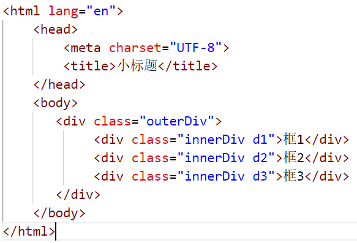


+ 上面的代码生成的树如下：
+ 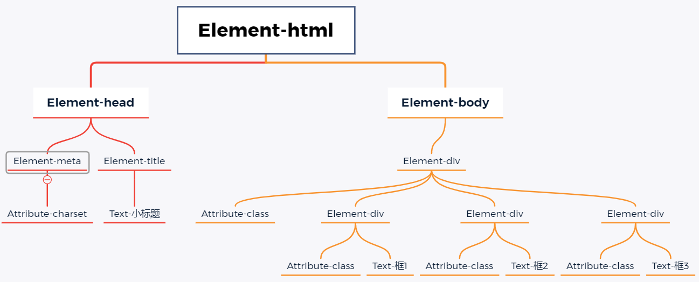

+ DOM编程其实就是用window对象的document属性的相关API完成对页面元素的控制的编程：
+ 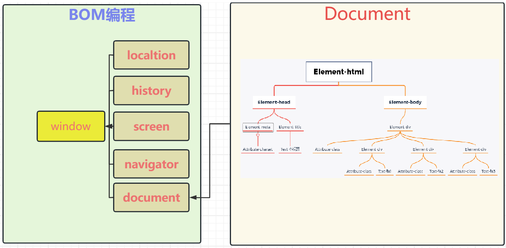

+ dom树中节点的类型：
    + node  节点，所有结点的父类型：
        + element   元素节点，node的子类型之一，代表一个完整标签；
        + attribute  属性节点，node的子类型之一，代表元素的属性；
        + text          文本节点，node的子类型之一，代表双标签中间的文本；

## 7.2 获取页面元素的几种方式

### 7.2.1 在整个文档范围内查找元素结点

| 功能               | API                                     | 返回值       |
| ------------------ | --------------------------------------- | ------------ |
| 根据id值查询       | document.getElementById(“id值”)         | 元素节点     |
| 根据标签名查询     | document.getElementsByTagName(“标签名”) | 元素节点数组 |
| 根据name属性值查询 | document.getElementsByName(“name值”)    | 元素节点数组 |
| 根据类名查询       | document.getElementsByClassName("类名") | 元素节点数组 |

### 7.2.2 在具体元素节点范围内查找子节点

| 功能               | API                       | 返回值         |
| ------------------ | ------------------------- | -------------- |
| 查找子标签         | element.children          | 返回子标签数组 |
| 查找第一个子标签   | element.firstElementChild | 标签对象       |
| 查找最后一个子标签 | element.lastElementChild  | 节点对象       |

### 7.2.3 查找指定子元素节点的父节点

| 功能                     | API                   | 返回值   |
| ------------------------ | --------------------- | -------- |
| 查找指定元素节点的父标签 | element.parentElement | 标签对象 |

### 7.2.4  查找指定元素节点的兄弟节点

| 功能               | API                         | 返回值   |
| ------------------ | --------------------------- | -------- |
| 查找前一个兄弟标签 | node.previousElementSibling | 标签对象 |
| 查找后一个兄弟标签 | node.nextElementSibling     | 标签对象 |

``` html
代码见视频  p47
```

## 7.3 操作元素属性值

### 7.3.1 属性操作

| 需求       | 操作方式                   |
| ---------- | -------------------------- |
| 读取属性值 | 元素对象.属性名            |
| 修改属性值 | 元素对象.属性名=新的属性值 |

### 7.3.2 内部文本操作

| 需求                         | 操作方式          |
| ---------------------------- | ----------------- |
| 获取或者设置标签体的文本内容 | element.innerText |
| 获取或者设置标签体的内容     | element.innerHTML |

``` text
代码见视频 p48
```

## 7.4 增删元素

### 7.4.1 对页面的元素进行增删操作

| API                                      | 功能                                       |
| ---------------------------------------- | ------------------------------------------ |
| document.createElement(“标签名”)         | 创建元素节点并返回，但不会自动添加到文档中 |
| document.createTextNode(“文本值”)        | 创建文本节点并返回，但不会自动添加到文档中 |
| element.appendChild(ele)                 | 将ele添加到element所有子节点后面           |
| parentEle.insertBefore(newEle,targetEle) | 将newEle插入到targetEle前面                |
| parentEle.replaceChild(newEle, oldEle)   | 用新节点替换原有的旧子节点                 |
| element.remove()                         | 删除某个标签                               |

``` html
<!DOCTYPE html>
<html lang="en">
<head>
    <meta charset="UTF-8">
    <meta name="viewport" content="width=device-width, initial-scale=1.0">
    <title>Document</title>
   <script>
    /* 
    1 获得document  dom树
        window.document
    2 从document中获取要操作的元素
        1）直接获取
            var el1 =document.getElementById("username") // 根据元素的id值获取页面上唯一的一个元素
            var els =document.getElementsByTagName("input") // 根据元素的标签名获取多个同名元素
            var els =document.getElementsByName("aaa") // 根据元素的name属性值获得多个元素
            var els =document.getElementsByClassName("a") // 根据元素的class属性值获得多个元素
        2）间接获取
            var cs=div01.children // 通过父元素获取全部的子元素
            var firstChild =div01.firstElementChild  // 通过父元素获取第一个子元素
            var lastChild = div01.lastElementChild   // 通过父元素获取最后一个子元素
            var parent = pinput.parentElement  // 通过子元素获取父元素
            var pElement = pinput.previousElementSibling // 获取前面的第一个元素
            var nElement = pinput.nextElementSibling // 获取后面的第一个元素
    3 对元素进行操作
        1）操作元素的属性   元素名.属性名=""
        2）操作元素的样式   元素名.style.样式名=""  样式名"-" 要进行驼峰转换
        3）操作元素的文本   元素名.innerText   只识别文本
                           元素名.innerHTML   同时可以识别html代码 
        4）增删元素
            var element =document.createElement("元素名") // 创建元素
            父元素.appendChild(子元素)               // 在父元素中追加子元素
            父元素.insertBefore(新元素,参照元素)     // 在某个元素前增加元素
            父元素.replaceChild(新元素,被替换的元素) // 用新的元素替换某个子子元素
            元素.remove()                            // 删除当前元素
    */
   function addCs(){
        // 创建一个新的元素
        // 创建元素
        var csli =document.createElement("li") // <li></li>
        // 设置子元素的属性和文本 <li id="cs">长沙</li>
        csli.id="cs"
        csli.innerText="长沙"
        // 将子元素放入父元素中
        var cityul =document.getElementById("city")
        // 在父元素中追加子元素
        cityul.appendChild(csli)
   }
   function addCsBeforeSz(){
        // 创建一个新的元素
        // 创建元素
        var csli =document.createElement("li") // <li></li>
        // 设置子元素的属性和文本 <li id="cs">长沙</li>
        csli.id="cs"
        csli.innerText="长沙"
        // 将子元素放入父元素中
        var cityul =document.getElementById("city")
        // 在父元素中追加子元素
        //cityul.insertBefore(新元素,参照元素)
        var szli =document.getElementById("sz")
        cityul.insertBefore(csli,szli)
   }
   function replaceSz(){
        // 创建一个新的元素
        // 创建元素
        var csli =document.createElement("li") // <li></li>
        // 设置子元素的属性和文本 <li id="cs">长沙</li>
        csli.id="cs"
        csli.innerText="长沙"
        // 将子元素放入父元素中
        var cityul =document.getElementById("city")
        // 在父元素中追加子元素
        //cityul.replaceChild(新元素,被替换的元素)
        var szli =document.getElementById("sz")
        cityul.replaceChild(csli,szli)
   }
   function removeSz(){
        var szli =document.getElementById("sz")
        // 哪个元素调用了remove该元素就会从dom树中移除
        szli.remove()
   }
   function clearCity(){      
        var cityul =document.getElementById("city")
        /* var fc =cityul.firstChild
        while(fc != null ){
            fc.remove()
            fc =cityul.firstChild
        } */
        cityul.innerHTML=""
        //cityul.remove()
   }   
   </script>
</head>
<body>
    <ul id="city">
        <li id="bj">北京</li>
        <li id="sh">上海</li>
        <li id="sz">深圳</li>
        <li id="gz">广州</li>
    </ul>
    <hr>
    <!-- 目标1 在城市列表的最后添加一个子标签  <li id="cs">长沙</li>  -->
    <button onclick="addCs()">增加长沙</button>
    <!-- 目标2 在城市列表的深圳前添加一个子标签  <li id="cs">长沙</li>  -->
    <button onclick="addCsBeforeSz()">在深圳前插入长沙</button>
    <!-- 目标3  将城市列表的深圳替换为  <li id="cs">长沙</li>  -->
    <button onclick="replaceSz()">替换深圳</button>
    <!-- 目标4  将城市列表删除深圳  -->
    <button onclick="removeSz()">删除深圳</button>
    <!-- 目标5  清空城市列表  -->
    <button onclick="clearCity()">清空</button>
</body>
</html>
```

# 八 正则表达式

## 8.1 正则表达式简介

> 正则表达式是描述字符模式的对象。正则表达式用于对字符串模式匹配及检索替换，是对字符串执行模式匹配的强大工具。

+ 语法 

``` javascript
var patt=new RegExp(pattern,modifiers);
或者更简单的方式:
var patt=/pattern/modifiers; 
```

> 修饰符：

| 修饰符                                             | 描述                                                     |
| :------------------------------------------------- | :------------------------------------------------------- |
| [i](https://www.runoob.com/js/jsref-regexp-i.html) | 执行对大小写不敏感的匹配。                               |
| [g](https://www.runoob.com/js/jsref-regexp-g.html) | 执行全局匹配（查找所有匹配而非在找到第一个匹配后停止）。 |
| m                                                  | 执行多行匹配。                                           |

> 方括号：

| 表达式                                                       | 描述                               |
| :----------------------------------------------------------- | :--------------------------------- |
| [[abc\]](https://www.runoob.com/jsref/jsref-regexp-charset.html) | 查找方括号之间的任何字符。         |
| [[^abc\]](https://www.runoob.com/jsref/jsref-regexp-charset-not.html) | 查找任何不在方括号之间的字符。     |
| [0-9]                                                        | 查找任何从 0 至 9 的数字。         |
| [a-z]                                                        | 查找任何从小写 a 到小写 z 的字符。 |
| [A-Z]                                                        | 查找任何从大写 A 到大写 Z 的字符。 |
| [A-z]                                                        | 查找任何从大写 A 到小写 z 的字符。 |
| [adgk]                                                       | 查找给定集合内的任何字符。         |
| [^adgk]                                                      | 查找给定集合外的任何字符。         |
| (red\|blue\|green)                                           | 查找任何指定的选项。               |

> 元字符：

| 元字符                                                       | 描述                                        |
| :----------------------------------------------------------- | :------------------------------------------ |
| [.](https://www.runoob.com/jsref/jsref-regexp-dot.html)      | 查找单个字符，除了换行和行结束符。          |
| [\w](https://www.runoob.com/jsref/jsref-regexp-wordchar.html) | 查找数字、字母及下划线。                    |
| [\W](https://www.runoob.com/jsref/jsref-regexp-wordchar-non.html) | 查找非单词字符。                            |
| [\d](https://www.runoob.com/jsref/jsref-regexp-digit.html)   | 查找数字。                                  |
| [\D](https://www.runoob.com/jsref/jsref-regexp-digit-non.html) | 查找非数字字符。                            |
| [\s](https://www.runoob.com/jsref/jsref-regexp-whitespace.html) | 查找空白字符。                              |
| [\S](https://www.runoob.com/jsref/jsref-regexp-whitespace-non.html) | 查找非空白字符。                            |
| [\b](https://www.runoob.com/jsref/jsref-regexp-begin.html)   | 匹配单词边界。                              |
| [\B](https://www.runoob.com/jsref/jsref-regexp-begin-not.html) | 匹配非单词边界。                            |
| \0                                                           | 查找 NULL 字符。                            |
| [\n](https://www.runoob.com/jsref/jsref-regexp-newline.html) | 查找换行符。                                |
| \f                                                           | 查找换页符。                                |
| \r                                                           | 查找回车符。                                |
| \t                                                           | 查找制表符。                                |
| \v                                                           | 查找垂直制表符。                            |
| [\xxx](https://www.runoob.com/jsref/jsref-regexp-octal.html) | 查找以八进制数 xxx 规定的字符。             |
| [\xdd](https://www.runoob.com/jsref/jsref-regexp-hex.html)   | 查找以十六进制数 dd 规定的字符。            |
| [\uxxxx](https://www.runoob.com/jsref/jsref-regexp-unicode-hex.html) | 查找以十六进制数 xxxx 规定的 Unicode 字符。 |

> 量词：

| 量词                                                         | 描述                                                         |
| :----------------------------------------------------------- | :----------------------------------------------------------- |
| [n+](https://www.runoob.com/jsref/jsref-regexp-onemore.html) | 匹配任何包含至少一个 n 的字符串。例如，/a+/ 匹配 "candy" 中的 "a"，"caaaaaaandy" 中所有的 "a"。 |
| [n*](https://www.runoob.com/jsref/jsref-regexp-zeromore.html) | 匹配任何包含零个或多个 n 的字符串。例如，/bo*/ 匹配 "A ghost booooed" 中的 "boooo"，"A bird warbled" 中的 "b"，但是不匹配 "A goat grunted"。 |
| [n?](https://www.runoob.com/jsref/jsref-regexp-zeroone.html) | 匹配任何包含零个或一个 n 的字符串。例如，/e?le?/ 匹配 "angel" 中的 "el"，"angle" 中的 "le"。 |
| [n{X}](https://www.runoob.com/jsref/jsref-regexp-nx.html)    | 匹配包含 X 个 n 的序列的字符串。例如，/a{2}/ 不匹配 "candy," 中的 "a"，但是匹配 "caandy," 中的两个 "a"，且匹配 "caaandy." 中的前两个 "a"。 |
| [n{X,}](https://www.runoob.com/jsref/jsref-regexp-nxcomma.html) | X 是一个正整数。前面的模式 n 连续出现至少 X 次时匹配。例如，/a{2,}/ 不匹配 "candy" 中的 "a"，但是匹配 "caandy" 和 "caaaaaaandy." 中所有的 "a"。 |
| [n{X,Y}](https://www.runoob.com/jsref/jsref-regexp-nxy.html) | X 和 Y 为正整数。前面的模式 n 连续出现至少 X 次，至多 Y 次时匹配。例如，/a{1,3}/ 不匹配 "cndy"，匹配 "candy," 中的 "a"，"caandy," 中的两个 "a"，匹配 "caaaaaaandy" 中的前面三个 "a"。注意，当匹配 "caaaaaaandy" 时，即使原始字符串拥有更多的 "a"，匹配项也是 "aaa"。 |
| [n$](https://www.runoob.com/jsref/jsref-regexp-ndollar.html) | 匹配任何结尾为 n 的字符串。                                  |
| [^n](https://www.runoob.com/jsref/jsref-regexp-ncaret.html)  | 匹配任何开头为 n 的字符串。                                  |
| [?=n](https://www.runoob.com/jsref/jsref-regexp-nfollow.html) | 匹配任何其后紧接指定字符串 n 的字符串。                      |
| [?!n](https://www.runoob.com/jsref/jsref-regexp-nfollow-not.html) | 匹配任何其后没有紧接指定字符串 n 的字符串。                  |

> RegExp对象方法：

| 方法                                                         | 描述                                               |
| :----------------------------------------------------------- | :------------------------------------------------- |
| [compile](https://www.runoob.com/jsref/jsref-regexp-compile.html) | 在 1.5 版本中已废弃。 编译正则表达式。             |
| [exec](https://www.runoob.com/jsref/jsref-exec-regexp.html)  | 检索字符串中指定的值。返回找到的值，并确定其位置。 |
| [test](https://www.runoob.com/jsref/jsref-test-regexp.html)  | 检索字符串中指定的值。返回 true 或 false。         |
| [toString](https://www.runoob.com/jsref/jsref-regexp-tostring.html) | 返回正则表达式的字符串。                           |

> 支持正则的String的方法：

| 方法                                                    | 描述                             |
| :------------------------------------------------------ | :------------------------------- |
| [search](https://www.runoob.com/js/jsref-search.html)   | 检索与正则表达式相匹配的值。     |
| [match](https://www.runoob.com/js/jsref-match.html)     | 找到一个或多个正则表达式的匹配。 |
| [replace](https://www.runoob.com/js/jsref-replace.html) | 替换与正则表达式匹配的子串。     |
| [split](https://www.runoob.com/js/jsref-split.html)     | 把字符串分割为字符串数组。       |

## 8.2 正则表达式体验

### 8.2.1 验证

**注意**：这里是使用正则表达式对象来调用方法。

```javascript
// 创建一个最简单的正则表达式对象
var reg = /o/;
// 创建一个字符串对象作为目标字符串
var str = 'Hello World!';
// 调用正则表达式对象的test()方法验证目标字符串是否满足我们指定的这个模式，返回结果true
console.log("/o/.test('Hello World!')="+reg.test(str));
```

### 8.2.2 匹配

```javascript
// 创建一个最简单的正则表达式对象
var reg = /o/;
// 创建一个字符串对象作为目标字符串
var str = 'Hello World!';
// 在目标字符串中查找匹配的字符，返回匹配结果组成的数组
var resultArr = str.match(reg);
// 数组长度为1
console.log("resultArr.length="+resultArr.length);
// 数组内容是o
console.log("resultArr[0]="+resultArr[0]);
```

### 8.2.3 替换

**注意**：这里是使用字符串对象来调用方法。

```javascript
// 创建一个最简单的正则表达式对象
var reg = /o/;
// 创建一个字符串对象作为目标字符串
var str = 'Hello World!';
var newStr = str.replace(reg,'@');
// 只有第一个o被替换了，说明我们这个正则表达式只能匹配第一个满足的字符串
console.log("str.replace(reg)="+newStr);//Hell@ World!
// 原字符串并没有变化，只是返回了一个新字符串
console.log("str="+str);//str=Hello World!
```

### 8.2.4  全文查找

+ 如果不使用g对正则表达式对象进行修饰，则使用正则表达式进行查找时，仅返回第一个匹配。使用g后，返回所有匹配。

```javascript
// 目标字符串
var targetStr = 'Hello World!';
// 没有使用全局匹配的正则表达式
var reg = /[A-Z]/;
// 获取全部匹配
var resultArr = targetStr.match(reg);
// 数组长度为1
console.log("resultArr.length="+resultArr.length);
// 遍历数组，发现只能得到'H'
for(var i = 0; i < resultArr.length; i++){
  console.log("resultArr["+i+"]="+resultArr[i]);
}
```

+ 对比

```javascript
// 目标字符串
var targetStr = 'Hello World!';
// 使用了全局匹配的正则表达式
var reg = /[A-Z]/g;
// 获取全部匹配
var resultArr = targetStr.match(reg);
// 数组长度为2
console.log("resultArr.length="+resultArr.length);
// 遍历数组，发现可以获取到“H”和“W”
for(var i = 0; i < resultArr.length; i++){
  console.log("resultArr["+i+"]="+resultArr[i]);
}
```

###  8.2.5 忽略大小写

```javascript
//目标字符串
var targetStr = 'Hello WORLD!';
//没有使用忽略大小写的正则表达式
var reg = /o/g;
//获取全部匹配
var resultArr = targetStr.match(reg);
//数组长度为1
console.log("resultArr.length="+resultArr.length);
//遍历数组，仅得到'o'
for(var i = 0; i < resultArr.length; i++){
  console.log("resultArr["+i+"]="+resultArr[i]);
}
```

+ 对比

```javascript
//目标字符串
var targetStr = 'Hello WORLD!';
//使用了忽略大小写的正则表达式
var reg = /o/gi;
//获取全部匹配
var resultArr = targetStr.match(reg);
//数组长度为2
console.log("resultArr.length="+resultArr.length);
//遍历数组，得到'o'和'O'
for(var i = 0; i < resultArr.length; i++){
  console.log("resultArr["+i+"]="+resultArr[i]);
}
```

### 8.2.6 元字符使用

```javascript
var str01 = 'I love Java';
var str02 = 'Java love me';
// 匹配以Java开头
var reg = /^Java/g;
console.log('reg.test(str01)='+reg.test(str01)); // false
console.log("<br />");
console.log('reg.test(str02)='+reg.test(str02)); // true
```

```javascript
var str01 = 'I love Java';
var str02 = 'Java love me';
// 匹配以Java结尾
var reg = /Java$/g;
console.log('reg.test(str01)='+reg.test(str01)); // true
console.log("<br />");
console.log('reg.test(str02)='+reg.test(str02)); // false
```

### 8.2.7 字符集合的使用

```javascript
//n位数字的正则
var targetStr="123456789";
var reg=/^[0-9]{0,}$/;
//或者 ： var reg=/^\d*$/;
var b = reg.test(targetStr);//true
```

```javascript
//数字+字母+下划线，6-16位
var targetStr="HelloWorld";
var reg=/^[a-z0-9A-Z_]{6,16}$/;
var b = reg.test(targetStr);//true
```

### 8.2.8  常用正则表达式

| 需求     | 正则表达式                                                 |
| -------- | ---------------------------------------------------------- |
| 用户名   | /^\[a-zA-Z ]\[a-zA-Z-0-9]{5,9}\$/                          |
| 密码     | /^\[a-zA-Z0-9 \_-@#& \*]{6,12}\$/                          |
| 前后空格 | /^\s+\|\s+\$/g                                             |
| 电子邮箱 | /^\[a-zA-Z0-9 \_.-]+@(\[a-zA-Z0-9-]+\[.]{1})+\[a-zA-Z]+\$/ |

# 九 案例开发-日程管理-第一期

## 9.1 登录页及校验

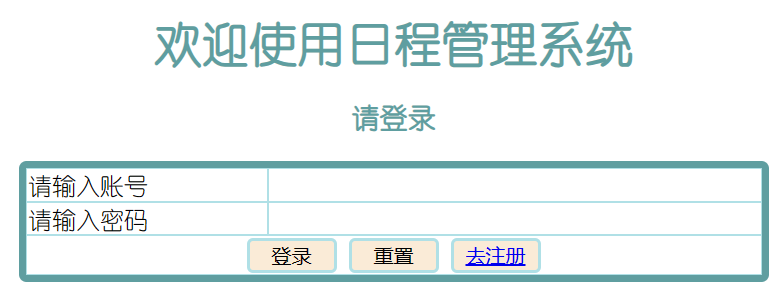


``` html
<!DOCTYPE html>
<html lang="en">
<head>
    <meta charset="UTF-8">
    <title>Title</title>
    <style>
        .ht{
            text-align: center;
            color: cadetblue;
            font-family: 幼圆;
        }
        .tab{
            width: 500px;
            border: 5px solid cadetblue;
            margin: 0px auto;
            border-radius: 5px;
            font-family: 幼圆;
        }
        .ltr td{
            border: 1px solid  powderblue;
        }
        .ipt{
            border: 0px;
            width: 50%;
        }
        .btn1{
            border: 2px solid powderblue;
            border-radius: 4px;
            width:60px;
            background-color: antiquewhite;
        }
        #usernameMsg , #userPwdMsg {
            color: rgb(230, 87, 51);
        }
        .buttonContainer{
            text-align: center;
        }
    </style>
    <script>
        // 检验用户名格式是否合法的函数
        function checkUsername(){
            // 定义正则表示字符串的规则
            var  usernameReg= /^[a-zA-Z0-9]{5,10}$/
            // 获得用户在页面上输入的信息
            var usernameInput =document.getElementById("usernameInput")
            var username = usernameInput.value
            // 获得格式提示的框
            var usernameMsg =document.getElementById("usernameMsg")
            // 格式有误时,返回false,在页面上提示
            if(!usernameReg.test(username)){ 
                usernameMsg.innerText="用户名格式有误"
                return false
            }
            // 格式OK,返回true 在页面上提示OK
            usernameMsg.innerText="OK"
            return true
        }
        // 检验密码格式是否合法的函数
        function checkUserPwd(){
            // 定义正则表示字符串的规则
            var  userPwdReg= /^[0-9]{6}$/
            // 获得用户在页面上输入的信息
            var userPwdInput =document.getElementById("userPwdInput")
            var userPwd = userPwdInput.value
            // 获得格式提示的框
            var userPwdMsg =document.getElementById("userPwdMsg")
            // 格式有误时,返回false,在页面上提示
            if(!userPwdReg.test(userPwd)){ 
                userPwdMsg.innerText="密码必须是6位数字"
                return false
            }
            // 格式OK,返回true 在页面上提示OK
            userPwdMsg.innerText="OK"
            return true
        }
        // 表单在提交时,校验用户名和密码格式,格式OK才会提交
        function checkForm(){
            var flag1 =checkUsername()
            var flag2 =checkUserPwd()
            return flag1&&flag2
        }
    </script>
</head>
<body>
    <h1 class="ht">欢迎使用日程管理系统</h1>
    <h3 class="ht">请登录</h3>
    <form method="post" action="/user/login" onsubmit="return checkForm()">
        <table class="tab" cellspacing="0px">
            <tr class="ltr">
                <td>请输入账号</td>
                <td>
                    <input class="ipt" type="text" id="usernameInput" name="username" onblur="checkUsername()">
                    <span id="usernameMsg"></span>
                </td>
            </tr>
            <tr class="ltr">
                <td>请输入密码</td>
                <td>
                    <input class="ipt" type="password" id="userPwdInput"  name="userPwd" onblur="checkUserPwd()">
                    <span id="userPwdMsg"></span>
                </td>
            </tr>
            <tr class="ltr">
                <td colspan="2" class="buttonContainer">
                    <input class="btn1" type="submit" value="登录">
                    <input class="btn1" type="reset" value="重置">
                    <button class="btn1"><a href="regist.html">去注册</a></button>
                </td>
            </tr>
        </table>
    </form>
</body>
</html>
```

## 9.2 注册页及校验

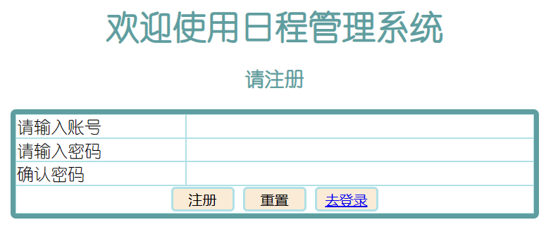


``` html
<!DOCTYPE html>
<html lang="en">
<head>
    <meta charset="UTF-8">
    <title>Title</title>
    <style>
        .ht{
            text-align: center;
            color: cadetblue;
            font-family: 幼圆;
        }
        .tab{
            width: 500px;
            border: 5px solid cadetblue;
            margin: 0px auto;
            border-radius: 5px;
            font-family: 幼圆;
        }
        .ltr td{
            border: 1px solid  powderblue;
        }
        .ipt{
            border: 0px;
            width: 50%;
        }
        .btn1{
            border: 2px solid powderblue;
            border-radius: 4px;
            width:60px;
            background-color: antiquewhite;
        }
        .msg {
            color: gold;
        }
        .buttonContainer{
            text-align: center;
        }
    </style>
    <script>
        function checkUsername(){
            var usernameReg = /^[a-zA-Z0-9]{5,10}$/
            var usernameInput = document.getElementById("usernameInput")  
            var username = usernameInput.value  
            var usernameMsg = document.getElementById("usernameMsg")
            if(!usernameReg.test(username)){
                usernameMsg.innerText="格式有误"
                return false
            } 
            usernameMsg.innerText="OK"
            return true 
        }
        function checkUserPwd(){
            var userPwdReg = /^\d{6}$/
            var userPwdInput = document.getElementById("userPwdInput")  
            var userPwd = userPwdInput.value  
            var userPwdMsg = document.getElementById("userPwdMsg")
            if(!userPwdReg.test(userPwd)){
                userPwdMsg.innerText="格式有误"
                return false
            } 
            userPwdMsg.innerText="OK"
            return true 
        }
        function checkReUserPwd(){
            var userPwdReg = /^\d{6}$/
            // 再次输入的密码的格式
            var reUserPwdInput = document.getElementById("reUserPwdInput")  
            var reUserPwd = reUserPwdInput.value 
            var reUserPwdMsg = document.getElementById("reUserPwdMsg")
            if(!userPwdReg.test(reUserPwd)){
                reUserPwdMsg.innerText="格式有误"
                return false
            } 
            // 获得上次密码,对比两次密码是否一致
            var userPwdInput = document.getElementById("userPwdInput")  
            var userPwd = userPwdInput.value  
            if(reUserPwd != userPwd){
                reUserPwdMsg.innerText="两次密码不一致"
                return false
            } 
            reUserPwdMsg.innerText="OK"
            return true 
        }
        function checkForm(){
            var flag1 = checkUsername()
            var flag2 = checkUserPwd()
            var flag3 = checkReUserPwd()

            return flag1 && flag2 && flag3
        }
    </script>   
</head>
<body>
<h1 class="ht">欢迎使用日程管理系统</h1>
<h3 class="ht">请注册</h3>
<form method="post" action="/user/regist" onsubmit="return checkForm()">
    <table class="tab" cellspacing="0px">
        <tr class="ltr">
            <td>请输入账号</td>
            <td>
                <input class="ipt" id="usernameInput" type="text" name="username" onblur="checkUsername()">
                <span id="usernameMsg" class="msg"></span>
            </td>
        </tr>
        <tr class="ltr">
            <td>请输入密码</td>
            <td>
                <input class="ipt" id="userPwdInput" type="password" name="userPwd" onblur="checkUserPwd()">
                <span id="userPwdMsg" class="msg"></span>
            </td>
        </tr>
        <tr class="ltr">
            <td>确认密码</td>
            <td>
                <input class="ipt" id="reUserPwdInput" type="password" onblur="checkReUserPwd()">
                <span id="reUserPwdMsg" class="msg"></span>
            </td>
        </tr>
        <tr class="ltr">
            <td colspan="2" class="buttonContainer">
                <input class="btn1" type="submit" value="注册">
                <input class="btn1" type="reset" value="重置">
                <button class="btn1"><a  href="login.html">去登录</a></button>
            </td>
        </tr>
    </table>
</form>
</body>
</html>
```
